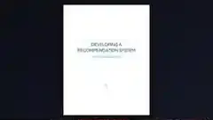

# AI Recommendation Engine

## Project overview

A recommendation prototype designed to help users find relevant movies, books or products using collaborative and content-based filtering.

## Tools and technologies

Python, Pandas, NumPy, Scikit-learn

## Portfolio note

This folder contains the project preview image and a short project summary. It is intended as a public portfolio reference.
