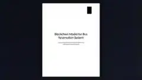

# Blockchain Bus Reservation Model

## Project overview

A technical model exploring bus and passenger reservation records using blockchain concepts and ledger operations.

## Tools and technologies

Blockchain, Distributed Ledger, System Design

## Portfolio note

This folder contains the project preview image and a short project summary. It is intended as a public portfolio reference.
