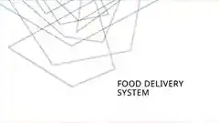

# Food Delivery System — OOAD

## Project overview

An object-oriented system design package outlining customers, restaurants, delivery staff, administration and the order lifecycle.

## Tools and technologies

OOAD, UML, Requirements Analysis

## Portfolio note

This folder contains the project preview image and a short project summary. It is intended as a public portfolio reference.
