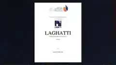

# LAGHATTI — Language Learning UX Platform

## Project overview

A multimedia language-learning concept supported by UX research, personas, user journeys, user flows and interface prototyping.

## Tools and technologies

UX Research, Figma, Wireframes, Prototyping

## Portfolio note

This folder contains the project preview image and a short project summary. It is intended as a public portfolio reference.
