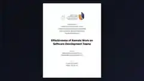

# Remote Work & Software Team Productivity Research

## Project overview

A research analysis of remote and office-based software teams, examining productivity, collaboration, satisfaction and stress, with documented modelling limitations.

## Tools and technologies

Python, Machine Learning, Statistical Analysis, Research

## Portfolio note

This folder contains the project preview image and a short project summary. It is intended as a public portfolio reference.
