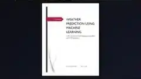

# Weather Prediction Using Machine Learning

## Project overview

A rain-prediction application built from historical weather data, comparing MLP and SVM models through a simple user interface.

## Tools and technologies

Python, Pandas, Scikit-learn, MLP, SVM, Gradio

## Project files

- `weather-prediction-report.pdf` — project report.
- `weather-prediction-training.py` — model training script.
- `weather-prediction-gradio-app.py` — Gradio interface.
- `weather-prediction-dataset.csv` — weather dataset.
- `weather-prediction-model.pkl` and `weather-prediction-scaler.pkl` — serialized model assets. Only load trusted pickle files.
- `cover.webp` — portfolio preview.
