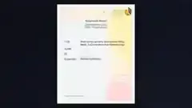

# Web Application Security Assessment

## Project overview

A documented server-security review using Nikto to identify configuration weaknesses and potentially exposed information.

## Tools and technologies

Nikto, Web Security, Security Assessment

## Portfolio note

This folder contains the project preview image and a short project summary. It is intended as a public portfolio reference.
